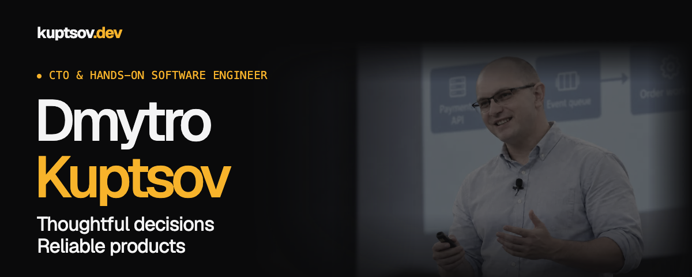
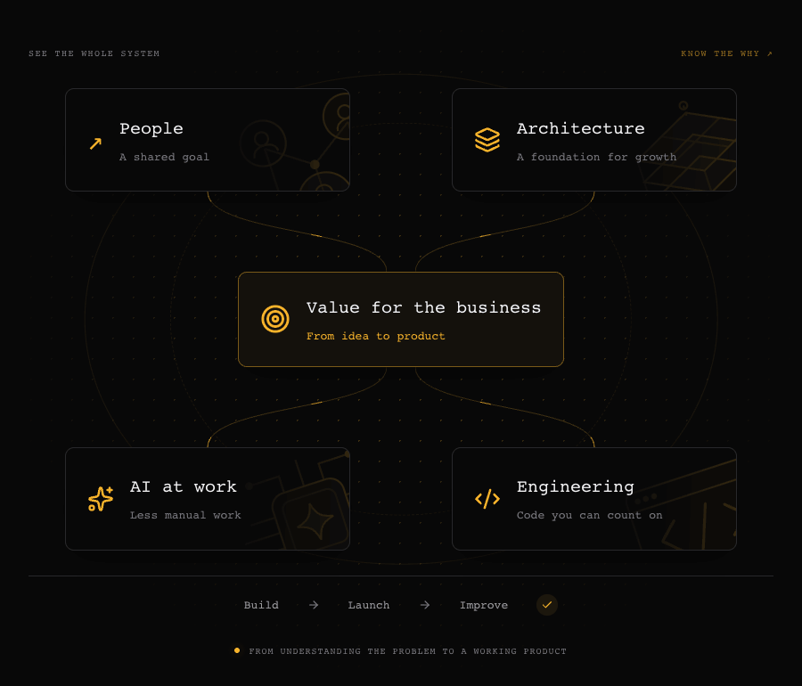
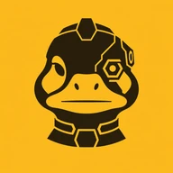

  <a href="https://kuptsov.dev/en/">Website</a> &nbsp; · &nbsp;
  <a href="https://www.linkedin.com/in/dmytro-kuptsov/">LinkedIn</a> &nbsp; · &nbsp;
  <a href="https://t.me/dkuptsov_ua">Telegram</a>

I help businesses build products they can rely on and grow with. I design the architecture, write code, and lead teams through launch. My experience spans product platforms, payments, high-traffic systems, integrations, and AI solutions.

## Close to the code, closer to the purpose

- **Architecture that makes sense.** Clear boundaries, thoughtful trade-offs, and systems the team can confidently maintain and extend.
- **Technical leadership grounded in delivery.** Connect decisions to the business problem, help people take ownership, and carry the work into production.
- **AI that earns its place.** Give agents useful context, tools, and guardrails. Automate routine work while keeping engineering judgment and accountability with people.

## Ideas taking shape

I’m building **[Vysliv](https://vysliv.com/en/)** to make serious software development and ongoing product support accessible to more businesses, whatever their engineering capacity.

Three products, one connected direction. **All are in development.**

<table>
  <tr>
    <td width="64" align="center"></td>
    <td><strong><a href="https://vysliv.com/en/dashduck/">Dashduck</a></strong> A shared workspace for coding agents. Keep parallel work connected and stay in control of the outcome.</td>
  </tr>
  <tr>
    <td width="64" align="center"></td>
    <td><strong>Owlden</strong> Knowledge that stays connected to the work. Give people and agents the context they need, with clear ownership and controlled access.</td>
  </tr>
  <tr>
    <td width="64" align="center"></td>
    <td><strong>Duckwin</strong> From a product idea to software that keeps evolving. Bring planning, development, delivery, and ongoing improvement into a controlled workflow.</td>
  </tr>
</table>

## Experience behind the decisions

**Developer → Tech Lead → CTO at [Blazing Boost](https://blazingboost.com/).** My work spans the marketplace, an in-house support chat system, an AI assistant, and analytics. I connect the architecture, the team’s direction, and delivery with the needs of the business.

Previously, I worked on high-traffic billing systems and payment processor integrations at **Together Networks**, development and dev leadership at **Giraffe Software**, projects for **Parimatch through Clickable**, and advertising-service integrations at **Netpeak (now Fractal)**.

I’ve also mentored PHP students through code reviews and hands-on guidance. Helping someone understand the reasoning behind a change is part of the work I enjoy.

[More about my experience, mentoring, and learning →](https://kuptsov.dev/en/#about)

## Good conversations open doors

Have an idea, want to compare notes, or just want to connect? I’d love to hear from you. We can talk about your business, technology, or a shared interest.

**[Let’s talk on LinkedIn ↗](https://www.linkedin.com/in/dmytro-kuptsov/)** &nbsp; · &nbsp; **[Message me on Telegram ↗](https://t.me/dkuptsov_ua)**

---

Engineered with care in Ukraine 🇺🇦

